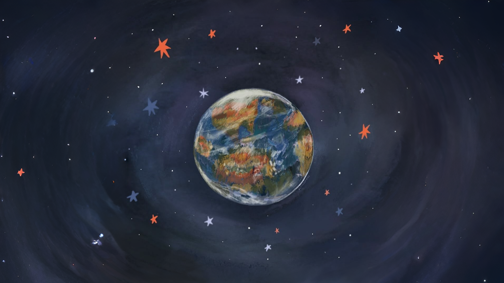
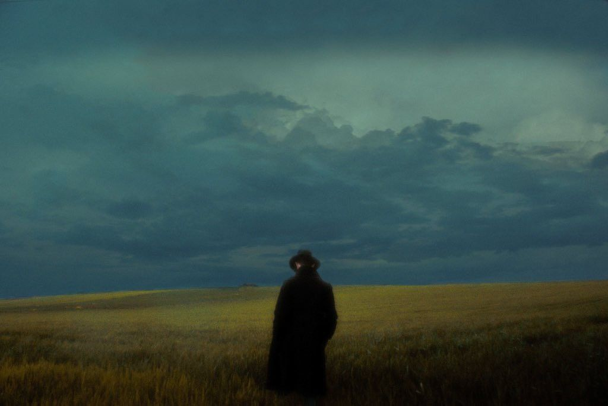
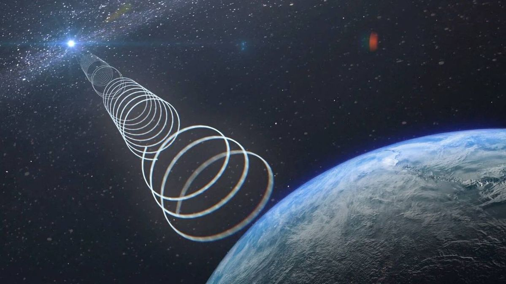
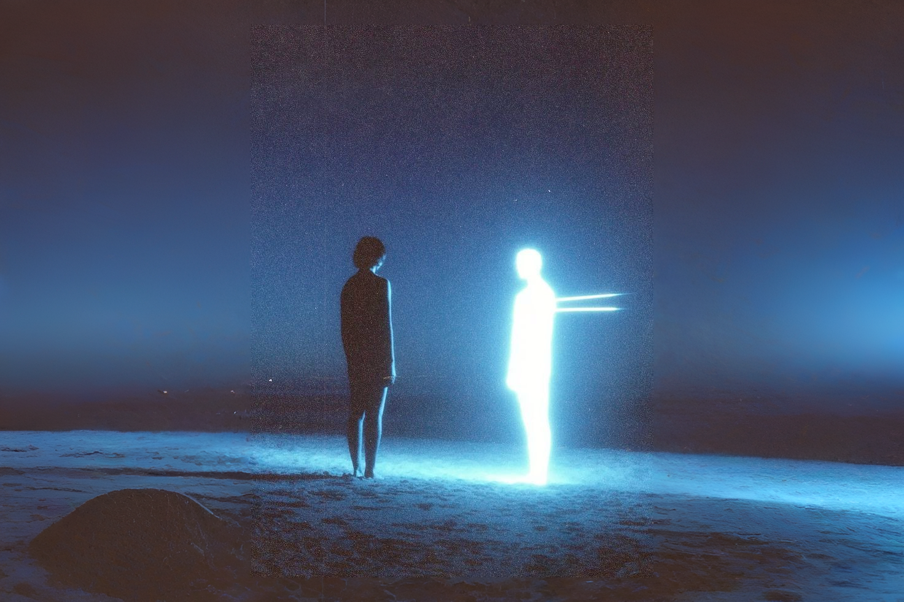

Xin chào mọi người, mình là Trái Đất. Từ khi sinh ra, mình đã biết trong vũ trụ rộng lớn này có rất nhiều những hành tinh và vì sao khác, mỗi loại lại mang một đặc điểm, hình dạng và trạng thái đặc trưng khác nhau. Dù vậy, cho đến hiện tại, mình đang biết rằng bản thân mình là hành tinh duy nhất có sự sống. Mình có một Mặt Trời đầy ấm áp để xoay quanh, có một Mặt Trăng làm vệ tinh ở trong quỹ đạo, và có hằng hà sa số những ngôi sao hay thực thể lân cận. Nhưng mình vẫn không thoát khỏi suy nghĩ là: liệu Trái Đất có phải hành tinh đơn độc duy nhất có sự sống? Cho dù Trái Đất đã thử rất nhiều cách để tìm kiếm, từ những tàu thăm dò hiện đại nhất, đến những loại kính viễn vọng tối tân, vẫn chẳng thể tìm thấy một nền văn minh nào khác ngoài kia. Chắc là vì trình độ công nghệ còn quá non nớt hay cách tìm kiếm vẫn chưa chuẩn chỉnh, nên mình vẫn chưa thể nào tìm ra họ, dù cho có nỗ lực và đưa ra thử nghiệm khác nhau đi chăng nữa. Mặc dù vậy, điều đó chẳng thể nào ngăn cản từng tế bào bên trong mình, hay, từng cá thể loài người trên Trái Đất, có chung một suy nghĩ là đâu đó ngoài vũ trụ rộng lớn đen kịt kia sẽ có nhiều hành tinh chứa những sinh vật, cá thể có trí thông minh, và ôm cả một nỗi cô độc tương tự. Suy nghĩ thôi vẫn là chưa đủ, nên sau cùng thì, hiện tại Trái Đất vẫn đang một mình thôi :))) 

<figure class="post-image" style="text-align: center;">
    
    <figcaption style="font-size: 0.8rem"></figcaption>
</figure>
 

Đoạn trên chỉ là một chút liên tưởng và ẩn dụ khá cồng kềnh của bản thân mình để miêu tả cái tâm trạng bây giờ. Ví von tâm trí mình là một vũ trụ tí hon, nơi mà cái bản thể này được đóng vai Trái Đất, bởi vậy nên mình xem nó là nơi có sự sống duy nhất, còn những cá thể con người xung quanh mình là những hành tinh, vì sao mà mình đang cố tìm cách để kết nối, phát đi những tín hiệu và hi vọng nếu họ có sự sống tương tự (hoặc mong mụốn tương tự), mình sẽ nhận được những phản hồi cho tín hiệu đó. 

## Sự cô độc vĩnh cửu

Nghe dở hơi đúng không? Chẳng qua mình không tìm được cách nào văn vẻ hơn và đỡ thô hơn khi nói về mong muốn đó của bản thân. Bóc tách một chút về nó, rằng tại sao mình phải đi tìm một sự sống khác như thế? Việc cứ "một mình", là sự sống duy nhất như thế chưa đủ hay sao?

Mình đã chẳng mất nhiều thời gian để suy nghĩ cho câu trả lời, và đáp án luôn luôn là chưa đủ. Thứ mình cần khi đi tìm nó là sự thấu hiểu, và dưới sâu hơn nữa, là sự lo sợ cái cảm giác cô độc vĩnh cửu. Mình, hay các cá thể loài người khác, luôn có tập tính xã hội và bầy đàn cao, được hình thành trong quá trình tiến hóa. Trong thời nguyên thủy, việc bị cô lập khỏi bộ lạc đồng nghĩa với cái chết; và từ đó, não bộ tiến hóa để phát ra cảm giác đau đớn về mặt tâm lý nhằm ép buộc người đó phải quay lại hoặc tìm kiếm một bộ lạc mới để được bảo vệ. Còn hiện nay, mình thấy cái cảm giác "đau đớn về mặt tâm lý" đó xảy ra khi những suy nghĩ, cảm xúc thực sự của mình bị che đậy, dồn nén, không được lắng nghe, chia sẻ trọn vẹn hoặc tôn trọng. Chính điều này đã khiến bản thân mình cảm thấy bị cô độc, hay, lạc lối trong cái vũ trụ tư tưởng nhỏ bé mà bản thân nuôi nấng trong tâm trí.

<figure class="post-image" style="text-align: center;">
    
    <figcaption style="font-size: 0.8rem"></figcaption>
</figure>
 

Vấn đề chắc chẳng phải là mình không có bạn bè để chia sẻ, trái lại mình cũng có tương đối nhiều bạn bè để nói chuyện. Nhiều người bạn chơi từ nhỏ, có những người cũng 8-9 năm rồi, và mình cũng chia sẻ nhiều chuyện với họ. Tuy vậy, mình chỉ có thể hoặc chỉ muốn nói ra một (hoặc một vài) phần tâm sự trong mình với họ, dù cho những cái mình tâm sự đó thường rất sâu, tựa như moi một phần ruột gan ra vậy :))). Nhưng, phần lớn suy nghĩ còn lại, mình lại giấu đi thật kĩ, không chia sẻ cho bất kì ai, như đi chôn một kho báu cho mười đời sau vậy. Chẳng phải mình không tin tưởng họ, cũng chẳng phải mình đang lo sợ rằng sau khi biết được, họ sẽ nhìn mình bằng con mắt khác, mà chỉ đơn giản là mình thiếu đi cái cảm xúc, một chất xúc tác để bắt đầu, và quan trọng hơn, là cả cách để diễn đạt những thứ rối tung đó sao cho trọn vẹn và chỉn chu nhất.

## Giới hạn của Trái Đất

> Chà, lại một lần nữa, Trái Đất đang phải đối mặt với một nút thắt cổ chai, đó là phương thức gửi tín hiệu, hay cụ thể là sự giới hạn về khoa học công nghệ để có thể phát đi những tín hiệu về sự sống đến được các hành tinh khác.

Hình dung như sau: một hành tinh khác có sự sống, họ gửi một tín hiệu đến Trái Đất. Sau khi nhận được, Trái Đất muốn gửi lại cho hành tinh đó một tín hiệu, nhưng vì không tìm ra được cách, những tín hiệu gửi đi thường bị lệch, méo mó, hao hụt hoặc chậm chạp và biến mất. Đôi khi chắc phải cả hàng nghìn hàng vạn năm mới tới nơi ấy chứ :v. Vậy nên, dù biết sự sống ngoài kia tồn tại, nhưng Trái Đất chẳng thể nào đưa đến một lời nhắn, một câu chuyện, hay bất kỳ thứ gì được cả. 

Cũng như Trái Đất, mình thiếu đi những cách để có thể phát đi tín hiệu, đưa ra những cái suy nghĩ từ sâu bên trong của bản thân một cách dễ tiếp cận cho người khác, để cho họ cũng có thể hiểu, có thể biết được bản thân mình đang nghĩ gì, hoặc ít nhất, là cho họ biết rằng hành tinh này đang "có sự sống".  Nhiều khi mình tự hỏi, việc này khó đến mức vậy sao? Hay mình đã làm sai ở bước nào? Hay do mình bị khác biệt đến mức không phù hợp với mọi người nữa?

<figure class="post-image" style="text-align: center;">
    
    <figcaption style="font-size: 0.8rem"></figcaption>
</figure>
 

## Tự giả lập một hành tinh

> "Muốn được thấu hiểu thì việc đầu tiên cần làm là lắng nghe..."

Mình học cách lắng nghe mọi người. Ban đầu mình cứ nghĩ lắng nghe chỉ đơn giản là im lặng, và để cho đối phương tự nói ra hết những gì họ muốn. Nhưng rồi, mình nhận ra không phải thế, nên mình học cách đặt câu hỏi, nói những câu gợi mở để họ có thể dễ dàng tăng thêm "xúc tác" để chia sẻ hơn. Dần dần, mình bị chìm vào nó đến nỗi bắt đầu tập suy nghĩ giống họ, cùng họ trải qua những tâm sự đó một cách chân thực nhất, y như là mình cũng trải qua vậy. Có cảm giác như mình đang biến thành một bác sĩ tâm lý và nghe người bệnh chia sẻ vậy =)). Nhưng có một điều khá lạ là nếu nghe đối phương nói chuyện đủ lâu, mình gần như có thể giả lập được một phiên bản thiếu hoàn chỉnh của họ trong đầu. Từ đó mình tự độc thoại, hay chính xác hơn là tự tạo ra những đoạn hội thoại của bản thân với chính cái phiên bản giả lập đó thường xuyên. Hơn nữa, mình thấy việc nói chuyện với phiên bản giả lập (chứ không phải phiên bản thực tế ngoài đời) của họ khiến cho việc bộc lộ cái "kho báu" cảm xúc mình chôn sâu trước kia trở nên dễ dàng hơn bao giờ hết. Chắc có lẽ, suy cho cùng, mình chỉ đang độc thoại với bản thân mình, nên không hề có một rào cản nào cả. Và việc này, dần dần khiến mình bị "nghiện", bị say mê trò chuyện với phiên bản giả lập kia của đối phương mà mất đi sự hứng thú, hay "cảm xúc" để giao tiếp với họ ở đời thực. 

<figure class="post-image" style="text-align: center;">
    
    <figcaption style="font-size: 0.8rem"></figcaption>
</figure>
 
Tại sao ư? Mình đưa ra được 2 lí do chính. Thứ nhất, tại vì đôi khi phiên bản mình giả lập nó "khá" hoàn chỉnh, giống kiểu như loài người trên Trái Đất, sau khi tính toán được mô hình của hành tinh X, sẽ có thể dự đoán được những thay đổi tiếp theo của hành tinh này là gì, từ đó đưa ra đề xuất có nên can thiệp hay không? (cái này mình đọc được từ tiểu thuyết Tam Thể của Lưu Từ Hân, mọi người có thể tìm hiểu thêm nếu hứng thú). Cụ thể, việc giao tiếp dần dần sẽ trở nên khá chán và giảm sự kích thích tò mò ở nhiều chỗ, khi mình đã biết (đoán) được đối phương sẽ nghĩ gì hoặc nói gì về một vấn đề cụ thể nào đó, bởi đó là cái kết quả mà mình giả lập trong đầu. Lí do thứ 2, việc mình "thổ lộ" hết với đối phương (ở trong đầu) khiến mình mất đi hứng thú để làm điều tương tự trong đời thật. Cũng có thể vì mình quá cầu toàn, muốn họ hiểu hết những gì mình nghĩ, hoặc ít nhất là hiểu như cách mình hiểu những cảm xúc ở bên trong của họ. Tuy vậy, cách mình diễn giải chưa được tốt như đối phương, nên khi phản ứng của họ khác hoàn toàn những gì mình giả lập, toàn bộ cái chương trình trong đầu mình sẽ gần như sụp đổ và cần chạy lại từ đầu. Haizz...

## Thỏa hiệp với bản thân

Trong một lần nói chuyện với anh [Thuận](https://github.com/thuan2172001), anh bảo mình đại khái rằng: "*khi em kì vọng 1 người nào đó sẽ hiểu rõ em đến mức như thế trong khoảng thời gian chưa đủ nhiều thì sẽ rất khó, bởi mọi người có xuất phát và trải nghiệm gần như là khác nhau. Từ đó em sẽ dễ bị thất vọng, và lặp lại nhiều lần như thế thì sẽ thấy mệt. Đến khi đó, bản thân sẽ tự chọn cách thỏa hiệp, rằng nếu em chưa tìm được 1 người (có thể là người yêu hoặc tri kỉ,..) như mong muốn, thì bản thân sẽ tìm N người, mỗi người bù được 1 góc nào đó, và như thế thì thường dễ hơn*." Mình thấy góc nhìn này khá hay và bổ ích, ít nhất nó cũng đưa ra một hướng mà mình nghĩ là giải thích được nhiều hành vi mà bản thân mình đang làm hoặc dự định làm. Mình cũng không nghĩ việc thỏa hiệp như trên là xấu, mà trái lại nó cho mình thêm nhiều thời gian, nhiều không gian để mày mò, tập luyện khả năng diễn giải cảm xúc và suy nghĩ một cách phù hợp với từng đối tượng, mà vẫn giữ cho bản thân mình không bị cô lập nhiều về tâm trí. 

<figure class="post-image" style="text-align: center;">
    
    <figcaption style="font-size: 0.8rem"></figcaption>
</figure>
 

Tóm lại, Trái Đất vẫn đang loay hoay giữa cái vũ trụ đen kịt tí hon này, vừa đang cố gắng đi tìm những sự sống ở các hành tinh khác để thoát khỏi nỗi lo sợ cô độc vĩnh cửu. Nhưng cùng với đó, Trái Đất vẫn đang bận rộn xoay quanh một Mặt Trời đỏ rực, cũng có những vệ tinh và Mặt Trăng trên quỹ đạo, và có cả những hành tinh như Sao Hỏa, Sao Kim để có thể khám phá những bí ẩn mới 😊😊😊

