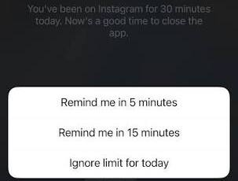
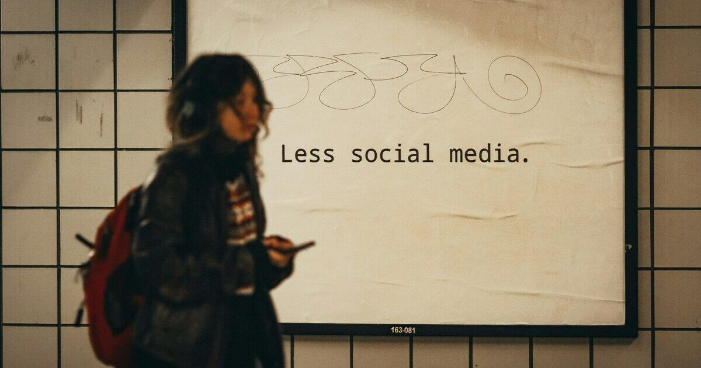
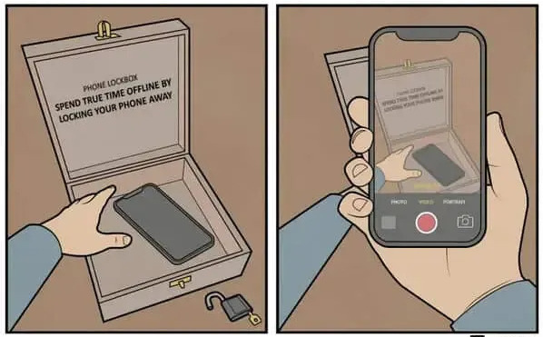
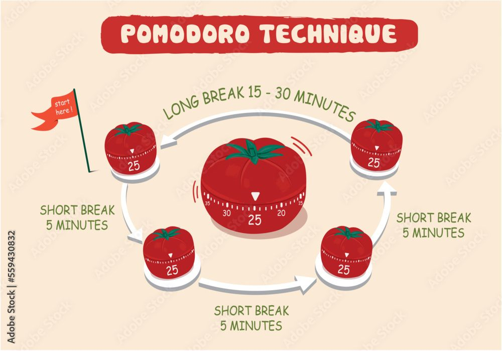
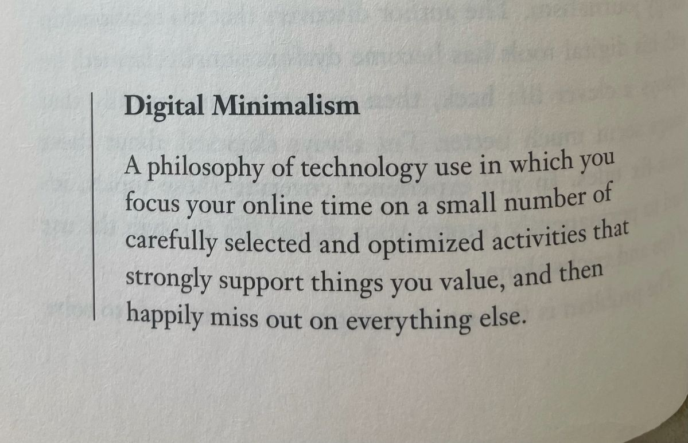

> Brainrot (hay là Thối não): là thuật ngữ chỉ tình trạng suy giảm trí tuệ, khả năng nhận thức hoặc sự mệt mỏi tinh thần do tiếp nhận quá nhiều nội dung trên internet có chất lượng thấp, vô nghĩa, lặp đi lặp lại hoặc phi lý. (Nguồn: Internet)

Đầu tiên, mình chưa đến mức bị Brainrot như thế, nhưng những tháng gần đây mình đang bị tiêu thụ nội dung ngắn hoặc vô nghĩa trên Internet quá mức, bị suy giảm khả năng tập trung, trí nhớ và sự kiên trì kỉ luật cũng bị giảm theo. Ở bài viết [trước](https://van-ghia.github.io/Blog/2026-08-11-qua-nhieu-phien-ban-minh-muon-tro-thanh.html), mình có chia sẻ là đang sống ở trên Internet quá nhiều, sử dụng mạng xã hội thường xuyên, và nó ảnh hưởng xấu trực tiếp đến khả năng tư duy, giao tiếp của bản thân. Hậu quả chắc mọi người cũng đoán được, chất lượng công việc giảm sút, cơ thể hay bị thiếu hụt năng lương, thiếu minh mẫn và nhìn mặt lúc nào cũng có vẻ bị ngơ ngơ. Đó là còn chưa kể đến nhiều lúc mình bị ngại ra đường, tiếp xúc hay giao lưu với bạn bè (Ở quê chắc bị đồn là nghiện rồi đấy :v). Nhận thấy tình trạng này không ổn rồi, nên mình quyết định thử nhiều cách khác nhau, nhằm cải thiện và phát triển lại não bộ của bản thân.

<figure class="post-image" style="text-align: center;">
    
    <figcaption style="font-size: 0.8rem"></figcaption>
</figure>
 

## Giảm sử dụng mạng xã hội 

Yes, nguồn gốc của nhiều vấn đề: Mạng xã hội. Mình không dùng Tiktok hay Threads, nhưng Instagram và Facebook là 2 thứ mình sử dụng, trong đó nhiều nhất là Instagram. Như đã chia sẻ ở bài trước, một e-boi như mình mà bị cắt hoàn toàn mạng xã hội thì không khác gì bị xóa đi 1 nửa danh tính vậy. Nên, mình không tiếp cận 1 cách "cực đoan" như nhiều bài viết hay video khác, mà mình cố gắng cắt giảm từ từ, từng chút một. Cụ thể, trong 2 tháng trước, mình lần lượt làm như sau:

- **Giới hạn thời gian sử dụng Instagram xuống 15p mỗi ngày**: Đây là cách dễ nhất vì nó là 1 tính năng xuất hiện mặc định trên app. Tuy vậy, mỗi lần mình lướt quá thời gian, thay vì đóng và khóa hẳn app, thì nó lại hiện 1 thông báo khá "vô dụng" như sau:
  <figure class="post-image" style="text-align: center;">
    
    <figcaption style="font-size: 0.8rem"></figcaption>
  </figure>
   

  Ban đầu mình chọn đóng app, nhưng chắc được 1-2 ngày gì đó. Những ngày tiếp theo, với 1 đứa nghiện như mình, lựa chọn "Bỏ qua" luôn được chọn như một phản xạ vô điều kiện, và mình lại tiếp tục sử dụng Instagram :v
- **Vô hiệu hóa tài khoản**: Mình vô hiệu hóa chúng trong khoảng 2 tuần. Cách này khá hữu ích, mình nhận ra không lướt reels nữa thì vẫn ổn, và may là mình chưa đến mức bị nghiện nặng như thế. Về Facebook, việc vô hiệu hóa tài khoản vẫn đảm bảo sử dụng Messenger bình thường nên khá chill. 
- **Xóa Mạng xã hội khỏi điện thoại**: Cách này không hiệu quả với mình lắm, vì mình vẫn kiểu: "Hmm, tải lại 1 chút xem sao nhỉ :))", và cứ xóa đi tải lại chắc cỡ chục lần gì đó. Ngoài ra, mình làm việc trên laptop thường ngày nên nếu xóa app ở điện thoại, mình vẫn có thể sử dụng chúng ở trên web.

- **Cách để không thể sử dụng Instagram trên web**: Mình làm 1 cách khá lạ như sau: 
  1) Đổi mật khẩu Instagram thành 1 dãy ngẫu nhiên, sau đó xóa cái dãy số đó đi. (Đến giờ mình không nhớ mật khẩu của mình). Dù vậy, nếu vào giao diện Instagram trên web, vẫn có option là "Đăng nhập bằng Facebook" và không cần mật khẩu.
  2) Vô hiệu hóa Facebook: cách này sẽ chặn luôn cách ở trên, nên mọi người sẽ không login vào Instagram được nữa.
  3) **Nếu không muốn vô hiệu hóa Facebook**: không sao, mình tìm được 1 cách khá hay. Thứ nhất bật Instagram trên điện thoại, tạo thêm 1 tài khoản nữa từ tài khoản gốc. Lúc này bạn sẽ có 2 tài khoản Instagram, kết nối đến 1 tài khoản Facebook của bạn. Sau đó, làm theo bước 1 với tài khoản mới. Giờ đây, khi đăng nhập Instagram trên web, nếu như bạn chọn: "Đăng nhập bằng Facebook", nó sẽ không cho bạn đăng nhập, bởi có 2 tài khoản và web sẽ không biết bạn muốn đăng nhập vào tài khoản nào.

Yeah, mình làm khá nhiều cách như thế chỉ để giảm thời gian lướt mạng một cách vô bổ. Ngoài ra mình chuyển sang lướt X, vì trên đó bảng feed của mình toàn thông tin về Cryptography, cũng khá hay để cập nhật tin tức hữu ích.

<figure class="post-image" style="text-align: center;">
    
    <figcaption style="font-size: 0.8rem"></figcaption>
</figure>
 

## Sự bất tiện có chủ đích

> Mình nhận ra rằng sự bất tiện khiến triệt tiêu đi ham muốn lướt mạng xã hội và những thú vui giải trí nhanh khác.

Mình nghiện sử dụng điện thoại vì nó mang đến sự giải trí một cách nhanh chóng (chưa đến 2s để bắt đầu), và não mình tiết ra (cheap) Dopamine liên tục trong lúc sử dụng liên tục như thế. Nên mình thử "tái lập trình" lại não, rằng cách cho nó biết rằng, để đạt được sự giải trí đó không còn nhanh chóng và dễ dàng như trước nữa, mà phải trải qua rất nhiều "thử thách", hay sự bất tiện có chủ đích.

Mình vẫn chọn giữ lại các ứng dụng mxh trên điện thoại, tại dù sao nó cũng là phương thức chính để mình liên lạc với mọi người. Nên để tránh bị phân tâm, mình đã thử đưa ra thử thách khác nhau để giảm thời gian sử dụng điện thoại trong lúc làm việc.
- **Sử dụng 2 điện thoại**. Bình tĩnh, không phải 2 điện thoại khiến mình tăng x2 thời gian lướt mạng đâu!!! Mình sử dụng chiếc Samsung A31 làm máy chính và máy phụ là iPhone13 Mini. Trên máy A31, mình chỉ tải Messenger, không có ứng dụng mạng xã hội nào khác. Máy này mình thường để bên cạnh trong khi làm việc để nếu có cuộc gọi hay ai đó cần liên lạc thì mình vẫn có thể nghe được. Để sử dụng các ứng dụng mxh, mình phải tải lại, chọn quên mật khẩu và cài lại,... Ngoài ra, vì máy đã được 6-7 năm nên khá lag, mang đến sự chờ đợi và bất tiện khá lớn khi sử dụng các ứng dụng trên.  Còn máy 13Mini, mình bỏ nó trong 1 cái hộp nhỏ, sau đó bỏ cái hộp bên trong 1 cái hộp to nữa, rồi bỏ nó vào trong cái vali, và cất vào nóc tủ :))) Việc này khá "cồng kềnh" và tốn khoảng 3p setup mỗi ngày. Nhưng bù lại, mỗi khi mình lên "cơn thèm" mạng xã hội, mình phải vượt qua 4 lớp rào chắn để có thể lấy được điện thoại và lướt. Điều này khiến mình gặp sự bất tiện có chủ đích, và nó giúp cho cái cơn thèm kia biến mất hoàn toàn.  Sau hơn 1 tuần thử, cách này với bản thân mình rất là hữu dụng nhé ^^.
  
  <figure class="post-image" style="text-align: center;">
    
    <figcaption style="font-size: 0.8rem"></figcaption>
  </figure>
   

- **Cài đặt các tiện ích chặn web**: Mình cài đặt trên Firefox các tiện ích để chặn Facebook, Instagram. Do đó khi "vô tình" vào các trang này, mình sẽ bị chặn :v. Cách này tương đối "không hữu ích" lắm vì đa phần những tiện ích đều cho phép mình bỏ chặn bằng 1 click, nên nó khá vô dụng với mình

Kết hợp những cách ở trên, mình phần nào đã giảm được thời gian bị phân tâm bởi điện thoại hay mạng xã hội trong lúc làm việc tương đối nhiều, nên khuyến khích mọi người thử cách các ở 2 phần trên nhé!!!

## Lấy lại năng lượng và sự tập trung

**Pomodoro**: Đợt còn là sinh viên năm 3, trong lúc đi thực tập, mình thấy anh Lead sử dụng 1 cái đồng hồ nhỏ để đo thời gian [Pomodoro](https://vi.wikipedia.org/wiki/Ph%C6%B0%C6%A1ng_ph%C3%A1p_qu%E1%BA%A3_c%C3%A0_chua), đại khái là ghi ra một việc cần làm, và trong khoảng thời gian Pomodoro đó chỉ tập trung 100% làm mỗi việc đó thôi, không để bất kì cái gì làm gián đoạn cả. Thường thì 1 lần sẽ là **25p tập trung - 5p nghỉ**. Lúc đó mình còn nghĩ trong đầu là: "Gà vch ~.~, 25p tập trung thì làm được gì :v.", bởi thời điểm đó, mình có thể dễ dàng tập trung lâu hơn 25p khá nhiều. Nhưng giờ, mình dễ bị phân tâm nhiều đến mức chưa chắc đã có thể làm được 25p mà không nhảy sang các Tab hay ứng dụng khác. Do vậy, mình quay lại sử dụng Pomodoro, để có thể ép não mình làm quen với mực độ tập trung, và dần dần có thể tăng lại thời gian tập trung. Tuy nhiên mình vẫn đang luyện tập, và mình thấy nó có hiệu quả, nhưng để nhanh chóng quay về lúc trước thì thật sự chưa đủ.

<figure class="post-image" style="text-align: center;">
    
    <figcaption style="font-size: 0.8rem"></figcaption>
</figure>
 

**Âm thanh**: Mình có thói quen bật âm thanh trong lúc làm việc, có thể là bài hát, nhạc lofi, không lời, hay các "tiếng ồn" khác,... Mình đã thử tương đối và thấy White noise + tiếng mưa phù hợp với bản thân, và nghe âm thanh này trong lúc làm việc khiến mình tăng sự tập trung và dễ chịu hơn. Gợi ý cho mọi người sử dụng trang web này nhé, rất nhiều âm thanh phù hợp cho cả việc học lẫn thư giãn: [myNoise](https://mynoise.net/).

Để có một ngày làm viêc hiệu quả, ngoài sự tập trung ra thì mình cần đảm bảo được cả **Thời gian** và **Năng lượng** nữa. Do vậy, mình vẫn đang cố gắng duy trì lại kỉ luật, sắp xếp thời gian sao cho hợp lý, hay như ở bài viết trước, là cố gắng không bị mất nhiều thời gian vào những sở thích chưa quan trọng. Việc giảm thời gian sử dụng điện thoại cũng giúp mình cân bằng lại thời gian ngủ một chút, giúp cơ thể thức dậy một cách sảng khoái hơn. Về thực phẩm, mình có đang thử ăn các loại hạt trong bữa phụ, như khoảng 10h sáng là 15h chiều để cơ thể không bị đói và thiếu hụt năng lượng. Mọi người có thể thử gói này, nhiều loại hạt và vị khác nhau, cũng rẻ và khá tiện để mang đi.

<figure class="post-image" style="text-align: center;">
    
    <figcaption style="font-size: 0.8rem"></figcaption>
</figure>
 

Ngoài ra gần đây mình cũng "chạm cỏ" nhiều hơn chút, gặp gỡ bạn bè nhiều hơn (may quá các bạn vẫn chơi với mình :vvv). Bọn mình cũng thử đi Trekking, rất mỏi chân nhưng vui lắm, và tự nhiên cũng thấy bắt đầu thích bộ môn này, hi vọng sắp tới có thể leo được nhiều đỉnh hơn với mọi người ^^

## Chủ nghĩa tối giản

Một người mình rất hâm mộ là [Vitalik Buterin](https://en.wikipedia.org/wiki/Vitalik_Buterin), sống theo chủ nghĩa tối giản. Gần đây trên blog của anh ấy có viết về Chủ nghĩa tối giản trên không gian số ([Digital Minimalism](https://vitalik.eth.limo/general/2026/10/31/digital_minimalism.html)), và đưa ra những phương pháp giúp anh ấy không bị cuốn vào quá nhiều sự toxic và thuật toán thu hút người dùng của các nền tảng mạng xã hội. Điều đặc biệt mình thấy là dù anh này vẫn hoạt động trên mạng xã hội thường xuyên, nhưng không để nó làm ảnh hưởng đến năng suất và khả năng tập trung hay những khía cạnh khác của cuộc sống. Do vậy, mình cũng đang thử áp dụng một vài thứ cơ bản của Chủ nghĩa tối giản, không chỉ trên không gian mạng mà cả trong cuộc sống hàng ngày nữa. Bắt đầu bằng việc là sắp xếp lại đồ dùng theo thời gian gần nhất sử dụng (hàng ngày - hàng tuần - hàng tháng - 3 tháng - 6 tháng - hàng năm - không dùng), sau đó loại bỏ, và đóng gói những thứ không thật sự cần thiết đi. Nghĩ lại thì cách này giúp không gian làm việc của mình gọn gàng hơn, cũng như ít những đồ vật, thiết bị làm mình phân tâm hơn. Mình vẫn đang tìm hiểu và áp dụng những gì phù hợp trong Chủ nghĩa này lên cuộc sống. Nếu sắp tới nó mang đến cho mình nhiều ý nghĩa hay giá trị gì đó thật sự nhiều, chắc chắn mình sẽ viết một bài mô tả chi tiết hơn. Và, nếu mọi người có ai đã hoặc đang thực hành Chủ nghĩa tối giản này, mình cũng muốn được kết nối và học hỏi thêm kinh nghiệm ạ ^^

<figure class="post-image" style="text-align: center;">
    
    <figcaption style="font-size: 0.8rem"></figcaption>
</figure>
 

## Lời kết

Mình vẫn đang cố để thoát khỏi những cám dỗ từ mạng xã hội, Internet, chứng nghiện điện thoại, Brainrot hay bất kể thứ gì tác động xấu đến não bộ và khả năng tư duy của bản thân. Mình tin là nhiều người vẫn đang giống như mình, cố tìm tòi và vượt qua những vấn đề trên. Do đó, thật tuyệt nếu bài viết này giúp ích được cho mọi người ở một vài khía cạnh nào đó hihi. Nếu mọi người có phương pháp gì hay, hãy comment và chia sẻ nhé. Peace!!!

 

