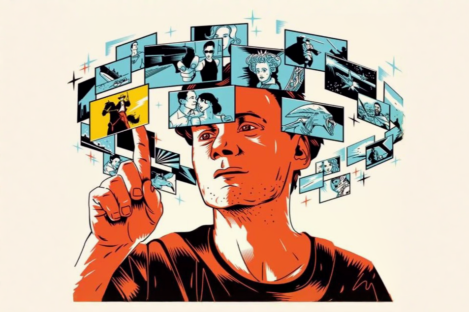
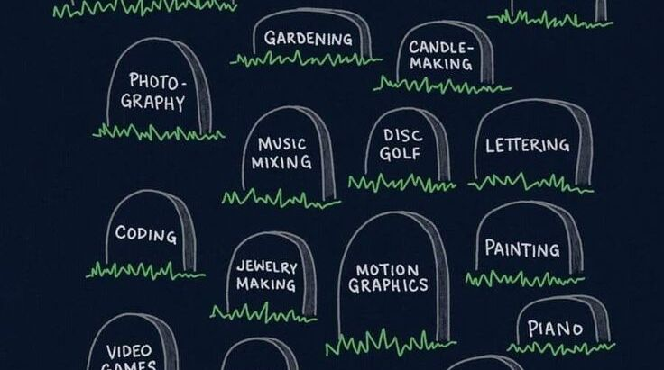
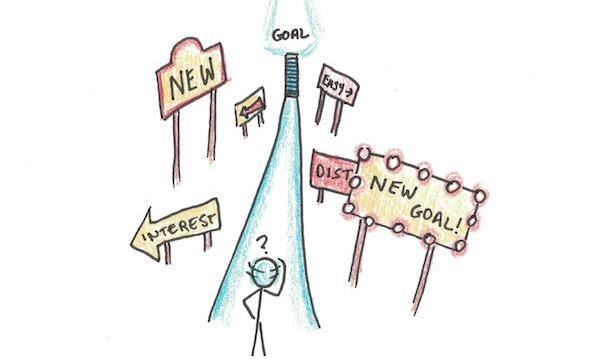
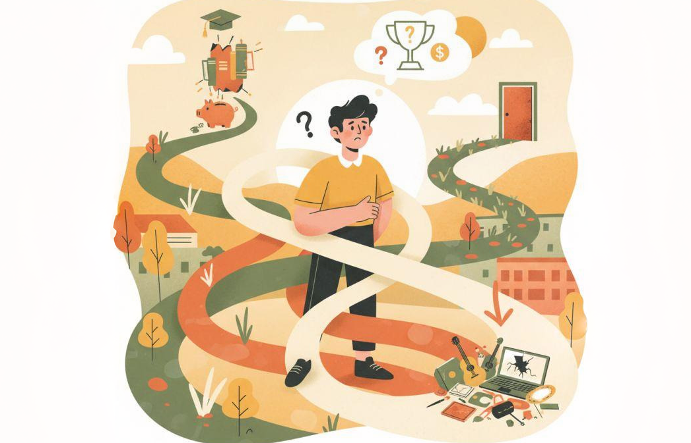

Không biết mọi người có từng bị điều này giống như mình hay không: Buổi sáng thức dậy, mình muốn phát triển bản thân về mặt chuyên môn và công việc nên tập trung hết lực để làm nó. Rồi đến 1 thời điểm giải lao, Spotify tự chuyển sang 1 bài hát nào đó rất hay hoặc hợp gu, mình lại nghĩ: "Ồ, bài này hay, mình thử hát xem sao!!", rồi mình mất 1 khoảng thời gian cho việc mang guitar ra hát hò các thứ. Khi đến buổi chiều, mình vô tình thấy một bài viết về chủ đề công nghệ mới mẻ nào đó, mình cứ nghĩ: "Cái này thú vị thật, không biết bên trong nó hoạt động như thế nào nhỉ??", và tiếp tục bỏ công sức lục lọi trên mạng để xem về kĩ thuật này. Cuối cùng đến tối, trong lúc lướt mạng xã hội hoặc xem Youtube, mình thấy việc làm Content creator cũng thú vị và hoàn toàn trong khả năng, nên mình lại bỏ ra hàng giờ để mày mò học edit video,... Điều này xảy ra thường xuyên, chỉ có chủ đề là thay đổi theo từng ngày. Cho đến cuối ngày, trước khi đi ngủ, mình tự "viễn tưởng" trong đầu về những phiên bản tương lai mà mình sẽ trở thành: một lập trình viên, nghệ sĩ, nhà sáng tạo nội dung, cầu thủ, doanh nhân, giảng viên, hoặc tỉ tỉ những phiên bản khác nữa, và chúng có vẻ chẳng liên quan gì đến nhau cả. Kì lạ ở chỗ, mình không thấy bản thân thiếu tiềm năng để trở nên như thế, mà trái lại, mình cảm thấy mình có sở thích và hứng thú với từng chủ đề, và tự thuyết phục bản thân rằng mình có thể làm trở thành phiên bản đó.

<figure class="post-image" style="text-align: center;">
    
    <figcaption style="font-size: 0.8rem"></figcaption>
</figure>
 

## Mình đang quan tâm đến quá nhiều thứ

Đúng vậy. Mình đang bị quan tâm đến nhiều thứ hơn mình nghĩ. Khi mình tình cờ thấy 1 kĩ năng/ domain nào đó mới mẻ và hứng thú, mình thường bỏ chút thời gian ra tìm hiểu và học hỏi. Nếu thấy hay, mình lại dành thêm 1 khoảng thời gian trong ngày nữa để phát triển nó. Tuy nhiên, việc này không hề kéo dài như mình mong muốn, bởi sau đó khoảng 1 thời gian, mình thấy cái khác hứng thú hơn, dành thời gian nhiều hơn và bỏ cái kĩ năng cũ mà mình từng muốn học đi :v. Không phải mình bị thiếu kỉ luật, trái lại mình luôn cố gắng tìm hiểu 1 thứ gì đó rất bài bản, trau truốt để có một nền tảng vỡ lòng tốt nhất. Tuy nhiên, cái mình gặp đó là sau khoảng thời gian nhất định, mình thiếu đi sự tò mò và sự nhiệt huyết để tiếp tục duy trì nó. Cái sự "tò mò và nhiệt huyết" đó không mất đi, mà nó chỉ nhảy từ cái sở thích/ kĩ năng này sang một cái kĩ năng khác mới lạ hơn mà mình vừa thấy được. Việc này theo mình thấy nó "khá" đúng với câu thành ngữ là: Cả thèm chóng chán ^^

<figure class="post-image" style="text-align: center;">
    
    <figcaption style="font-size: 0.8rem"></figcaption>
</figure>
 

Hậu quả là, mình mất quá nhiều thời gian đi tìm hiểu những thứ khá "vô bổ" cho bản thân, mà quên đi những việc quan trọng mình cần làm và cần phát triển. Tưởng tượng như mình thích và bắt đầu với 10 sở thích, nhưng chỉ 5 trong số đó qua được stage 1 (tức là sau khi tìm hiểu 1 chút và mình thấy nó hay), rồi có thể chẳng có cái nào qua được stage 2 (là sau khi bỏ hàng giờ tìm hiểu, mình quyết định sẽ duy trì nó mỗi ngày/ mỗi tuần,...). Sau đó mình lại bắt đầu vòng lặp trên với 10 sở thích/ lĩnh vực yêu thích khác, hoặc đôi khi, quay lại với 2-3 sở thích ban đầu. Mình nghĩ mình bị điều này khá là lâu rồi, nhưng gần đây nó đang bắt đầu trở nên rõ rệt và số lượng thời gian bị lãng phí đang ngày một nhiều lên. Kết quả là mình thấy mình biết thêm vài lĩnh vực, nhưng chẳng có cái nào đủ tốt hoặc đủ sâu để mang lại giá trị gì đó cho bản thân, ngoài việc thỏa mãn cái sự tò mò nhất thời cả. Nhiều lúc mình tự hỏi là, tại sao mình không thể chỉ tập trung cho 1 hoặc 2 thứ quan trọng, mà cứ bị nhảy sang quá nhiều thứ như thế? Mình có đang bị brainrot không? Hay mình bị vấn đề gì đó mà mình chưa tìm ra???

## Lí do phía sau

Sau khi tìm hiểu, mình thấy vấn đề mình đang gặp phải ở trên chẳng hề mới, và mình đã xem nhiều video giải thích về chủ đề này ([Link1](https://www.youtube.com/watch?v=3NGL3K6_iEk), [Link2](https://youtu.be/96TOwl10xZs?si=bY4U3qyPmTK9nQ78)). Theo mình nhận định thì có 2 lí do chính cho việc mình muốn trở thành nhiều phiên bản như ở trên. Thứ nhất là mình đang chưa quản lí được tâm lí lòng tham, tính tò mò và sự FOMO (sợ bị bỏ lỡ) của bản thân. Khi thấy người khác làm được, mình thường có suy nghĩ là: "Ok, nhìn cũng dễ đấy, chắc mình cũng làm được", và mình thường bắt đầu làm vì thấy người khác làm chứ chưa hẳn đã yêu thích nó. Ví dụ như lần mình xem 1 video về tâm lí hành vi hoặc nội dung nào đó khá "không hay", nhưng lượt view vẫn rất tốt. Mình chợt nghĩ liệu mình có thể làm được tương tự hay không, và bỏ ra hàng giờ để tìm hiểu cách xây script, làm animation (với AI), và edit video trên ứng dụng. Ngoài ra, mình đang tò mò với quá nhiều thứ, nhất là những thứ mới và nổi bật hiện nay. Cụ thể với lĩnh vực công nghệ, mình hay lướt X thấy những kĩ thuật đột phá là bị tò mò, sợ mình bỏ lỡ cái gì đó hấp dẫn nên bỏ thời gian ra để tìm hiểu những cái này. Dù với AI, mình tìm hiểu sẽ nhanh hơn nhưng nó vô tình làm ngắt quãng mạch suy nghĩ với công việc mình đang làm (vì những kĩ thuật đột phá đó rất rộng và đa dạng, phần lớn không liên quan đến lĩnh vực công việc lắm). Hơn nữa, mình tự thấy bản thân là một e-boy, dành phần lớn cuộc sống trên Internet, và khoe mẽ, flex trên mạng xã hội khá nhiều (dù phần lớn mình tự đánh giá là mình làm màu và hào nhoáng?). Nên việc có 1 kĩ năng mới để đi show off là một cái gì đó kích thích sự hứng thú từ mình. 

<figure class="post-image" style="text-align: center;">
    
    <figcaption style="font-size: 0.8rem"></figcaption>
</figure>
 

Lí do thứ hai, mình tự thấy bản thân có khao khát trải nghiệm khá lớn. Mình muốn được thử nhiều thứ, nhưng động lực phía sau chỉ là cảm giác hứng thú hay yêu thích nhất thời, mà thiếu tính duy trì và sự bền bỉ nhất định. Đó là nguồn gốc của việc với nhiều kĩ năng, khi đột nhiên giảm đi sự yêu thích, mình không còn thấy nhiều vẻ đẹp và sự thu hút để học và trau dồi cái kĩ năng đó nữa.

## Tìm cách giải quyết

Tất nhiên khi có bệnh, mình phải tìm cách để chữa trị, bởi mình không muốn bị rơi vào cái cảm giác mất động lực khi muốn làm quá nhiều thứ như trước kia (mình từng viết về điều này tại [đây](https://van-ghia.github.io/Blog/2024-27-08-mat-dong-luc.html)).  Đa phần những video hay bài viết mình đọc đều hướng dẫn mình cách sắp xếp mục tiêu và kĩ năng theo thứ tự ưu tiên trước, chia phần lớn thời gian để luyện tập nó từng ngày. Học cách bỏ đi những việc không thật sự quan trọng và không phù hợp để dành thời gian cho những việc khác. Mình cũng làm theo, bỏ đi cái dự định học piano, bỏ học lái xe, bỏ tập gym để thay vào đó bẳng việc dành thời gian để networking, viết lách, đá bóng, đánh cầu hay chạy bộ. Những việc đó là những thứ kĩ năng và sở thích mình thấy quan trọng, đã bị bỏ lại từ lâu hoặc  duy trì nhưng thời gian dành cho nó tương đối ít, nên mình cần điều chỉnh và sắp xếp lại. Dù vậy, mình vẫn đang vật lộn để quản lí cái sự tò mò và thời gian dành cho nó sao cho phù hợp. Tự đánh giá thấy cách quản lí thời gian của mình vẫn còn chưa tốt, nhưng mình lại thừa sự nhất quán để tuân theo cái chưa tốt đó. *Nôm na nó giống như mình biết mình đang đi đường vòng nhưng vì vẫn đang cảm thấy mình vẫn đi lên nên là mình vẫn cố chấp đi, chứ không chịu quan sát và điều chỉnh để tìm ra con đường nhanh hơn vậy.* 

<figure class="post-image" style="text-align: center;">
    
    <figcaption style="font-size: 0.8rem"></figcaption>
</figure>
 

Trong video mình giới thiệu ở trên, họ có đưa ra một phương pháp là hãy "tạm dừng" sự tò mò một chút, sau đó lên kế hoạch cụ thể cho nó trong khoảng thời gian nhất định. Chẳng hạn nếu thấy kĩ năng về guitar này hay, mình chưa cần phải bỏ ra hàng giờ luyện trong tuần đầu tiên, nhưng phải đặt mục tiêu là sau khoảng 1 tháng hoặc 2 tháng, mình sẽ đánh thuần thục bài này, hoặc tập đúng được kĩ năng guitar đó. Việc này khiến cho mình có nhiều thời gian hơn để quyết định và cân nhắc lượng công sức bỏ ra theo từng sở thích. Nghe cũng khá "khoa học" và logic đó, nhưng mình vẫn chưa thử =))). Nếu ai đã từng thử hoặc có những phương pháp nào đó hay hơn, thì giới thiệu cho mình biết với nhé.

## Tạm kết

> Not every interest becomes an identity. (Tạm dịch: Không phải sở thích nào cũng trở thành bản sắc)

Mình cũng thấy không nhất thiết thích âm nhạc, chơi guitar là phải trở thành nghệ sĩ, hay thích viết lách sẽ trở thành nhà văn. Vô số phiên bản mình mong muốn trở thành chắc sẽ chẳng bao giờ thành hiện thực, nhưng những cái đó vô tình giúp mình có thêm nhiều sự hứng thú và động lực để học thêm nhiều kĩ năng mới. Dù biết, cái gì quá cũng không tốt, và mình cũng đang loay hoay để điều chỉnh sao cho phù hợp nhất với bản thân mình. Nếu mọi người cũng gặp phải vấn đề tương tự, hi vọng bài viết có thể giúp ích gì đó cho mọi người, hoặc nếu có cách nào hay hơn, hãy chia sẻ cho mình với nhé !!!

